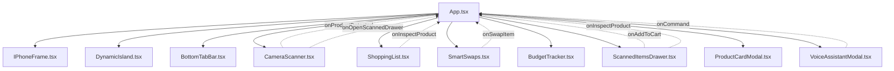

# SmartCart System Checkpoint & Developer Architecture Reference

> **Session Checkpoint**: September 15, 2026  
> **Workspace**: `/Users/s.hruthik/mani/Masters 26/HCI/SmartCart`  
> **Repository**: `https://github.com/Hruthik9/SmartCart` (branch `main`)  
> **Deployment Target**: Netlify (automatic continuous deployment on `git push origin main`)

---

## 1. System Overview & Technology Stack

SmartCart is a progressive web application structured with a decoupled, high-responsiveness architecture designed for retail store environments.

| Layer | Technology | Key Responsibilities |
| :--- | :--- | :--- |
| **Runtime & Bundler** | React 18 + Vite 8 (TypeScript) | Fast hot module replacement (HMR), sub-second build times. |
| **Styling & Design System** | Tailwind CSS + Vanilla CSS Tokens | iOS dark-mode glassmorphism (`backdrop-blur-xl`, `rgba(255,255,255,0.1)`), Apple SF-inspired typography, custom easing curves. |
| **Vision & AI Recognition** | Google GenAI SDK (`@google/genai`) + Web BarcodeDetector API | Native barcode detection with fallback to Gemini multimodal image analysis. |
| **Audio Synthesis** | Web Audio API (`AudioContext`) | Zero-asset mechanical camera shutter, scan beeps, swap chimes, and budget alert pulses. |
| **Speech Interface** | Web Speech API (`SpeechRecognition` & `SpeechSynthesis`) | Hands-free shopping commands and natural voice query responses. |
| **Persistence** | Browser `localStorage` API | Session history, live snapshots, and cart state preservation across refreshes. |
| **Mobile Web App (PWA)** | Web App Manifest + Service Worker (`sw.js`) | Standalone edge-to-edge iOS display, home screen installation. |

---

## 2. Component Hierarchy & State Flow



### Key State Variables in `App.tsx`

| State Variable | Type | Description |
| :--- | :--- | :--- |
| `cartItems` | `CartItem[]` | Active shopping cart items, quantities, checked status, and snapshot URLs. Synced to `localStorage` key `'smartcart_cart_items'`. |
| `scannedRecords` | `ScannedRecord[]` | Complete history of all products and live camera snapshots captured during the shopping walk. Synced to `localStorage` key `'smartcart_scanned_session_records'`. |
| `budgetLimit` | `number` | User-defined budget threshold (default: `$35.00`). |
| `currentTab` | `'scan' \| 'cart' \| 'swaps' \| 'budget'` | Active visual tab in the viewport. |
| `scannedProductModal` | `Product \| null` | Product currently open in the bottom-sheet inspection modal. |
| `isScannedDrawerOpen` | `boolean` | Visibility of the Scanned Snaps Session Drawer. |
| `dynamicIslandState` | `DynamicIslandState` | Active mode of the Dynamic Island (`idle`, `scanned`, `budget_alert`, `swap_saved`, `listening`). |
| `voiceAssistantOpen` | `boolean` | Visibility of the hands-free voice interface modal. |

---

## 3. Data Contracts & Interfaces (`src/types/grocery.ts`)

```typescript
export type NutriScore = 'A' | 'B' | 'C' | 'D' | 'E';

export type ProductCategory = 
  | 'Produce'
  | 'Dairy & Eggs'
  | 'Snacks & Sweets'
  | 'Beverages'
  | 'Bakery & Pantry'
  | 'Frozen'
  | 'Meat & Seafood'
  | 'Electronics & Tech'
  | 'Household & Cleaning'
  | 'Personal Care & Pharmacy'
  | 'Home & Kitchen'
  | 'Stationery & Office'
  | 'Apparel & Basics';

export interface Product {
  id: string;
  barcode: string;
  name: string;
  brand: string;
  category: ProductCategory;
  price: number;
  unit: string;
  image: string;
  snapshotUrl?: string; // Stored photo captured from live camera
  isFood?: boolean;
  nutriScore?: NutriScore;
  allergens?: string[];
  badges?: string[];
  specs?: Record<string, string>; // Hardware/non-food attributes
  storeAvailability?: string[]; // e.g. ["Walmart", "Target"]
  description?: string;
  healthierAlternativeId?: string;
  cheaperAlternativeId?: string;
  healthExplanation?: string;
  cheapExplanation?: string;
  nutrition?: {
    calories: number;
    sugars: string;
    sodium: string;
    fat: string;
    protein: string;
    fiber?: string;
  };
}

export interface CartItem {
  product: Product;
  quantity: number;
  addedVia: 'camera' | 'voice' | 'manual' | 'swap';
  timestamp: number;
  checked: boolean;
  snapshotUrl?: string;
}

export interface ScannedRecord {
  id: string;
  product: Product;
  snapshotUrl?: string;
  scannedAt: number;
}
```

---

## 4. Hardware & Camera Pipeline Details

### Viewfinder HUD & Shutter Lifecycle
1. **Target Area**: `w-72 h-72 max-w-[78vw] max-h-[42vh]` rounded 32px focus box with `shadow-[0_0_0_9999px_rgba(0,0,0,0.30)]` dark vignette mask.
2. **Shutter Button**: Double-ring optical button (white inner circle with outer translucent ring).
3. **Capture Sequence**:
   - `soundEffects.playCameraShutter()` triggers dual-click mechanical impulse audio.
   - `isFlashing = true` renders full-screen `bg-white/95` overlay for 180ms.
   - Active `<video>` frame is drawn to a bounded `<canvas>` (maximum dimension: 640px) to balance image fidelity with `localStorage` capacity.
   - Converted to JPEG data URL (`canvas.toDataURL('image/jpeg', 0.82)`).
   - Saved immediately into `scannedRecords` via `onProductDetected`, ensuring photos are never lost regardless of network status.

### Camera Hardware Binding Rules
- `video.srcObject = mediaStream` must be set synchronously.
- `video.setAttribute('playsinline', 'true')` and `video.setAttribute('webkit-playsinline', 'true')` are strictly required for iOS Safari fullscreen prevention.
- `activeStreamRef.current` stops all tracks (`track.stop()`) on tab unmount to prevent camera lockups.
- `public/_headers` must declare `Permissions-Policy: camera=*`.

---

## 5. Audio Synthesizer Parameters (`src/services/soundEffects.ts`)

| Sound Effect | Waveform / Method | Frequency & Duration |
| :--- | :--- | :--- |
| **Barcode Beep** | Sine wave | 1850Hz → 2400Hz (60ms) |
| **Swap Chime** | Dual Sine chords | 523.25Hz (C5) + 659.25Hz (E5) → 783.99Hz (G5) (350ms) |
| **Budget Alert** | Sawtooth wave | 330Hz → 220Hz (300ms double pulse) |
| **Camera Shutter** | White Noise Buffer + Biquad Bandpass Filter | Initial mechanical click (8ms) + main shutter impulse (35ms, 1200Hz Q=3) |

---

## 6. AI Vision & Supercenter Intelligence

- **Engine**: Gemini Multimodal Flash with fallback chain.
- **Classification**: Dynamically separates consumable groceries (`isFood: true`) from mart department merchandise (`isFood: false`).
- **Store-Brand Intelligence**: Maps branded goods to retailer equivalents:
  - Walmart: *Great Value* (Groceries/Household), *Equate* (Pharmacy/Personal Care), *onn.* (Electronics).
  - Target: *up & up* (Household/Pharmacy/Stationery), *Good & Gather* (Groceries), *Room Essentials* (Home).

---

## 7. Storage Management & Quota Protection

- **Key 1**: `smartcart_scanned_session_records`
  - Stores up to 25 items.
  - If a quota exception occurs, the system automatically preserves the full product catalog and strips heavy base64 data URLs from older items, keeping the most recent 5 snapshots intact.
- **Key 2**: `smartcart_cart_items`
  - Stores up to 50 active cart items.

---

## 8. Deployment Workflow

```bash
# Verify TypeScript & Production Bundle
npm run build

# Commit & Push to GitHub (Triggers Netlify Deployment)
git add .
git commit -m "feat/fix: <description>"
git push origin main
```
Netlify automatically detects commits to `origin/main` and deploys the production build to the live domain.
