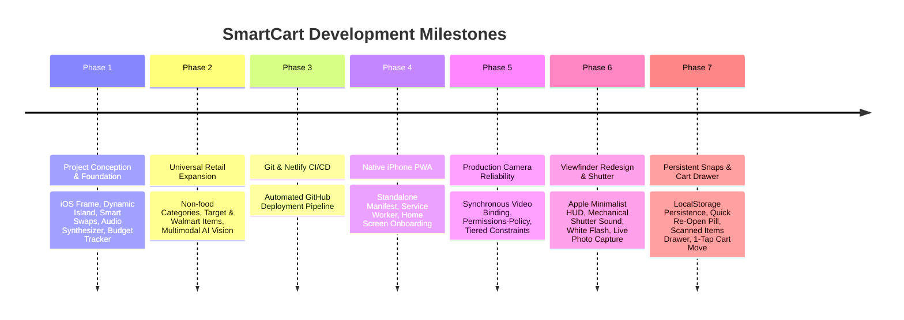

# SmartCart: Ambient AI Retail & Grocery Assistant
## Masters in Human-Computer Interaction (HCI) Project Walkthrough & Implementation Guide

---

## 1. Executive Summary & HCI Vision

**SmartCart** is an ambient, iOS-inspired AI shopping assistant developed to bridge the gap between physical retail store navigation and digital decision-making. Designed for both supermarket groceries and universal supercenters (**Walmart, Target, Costco, CVS, and electronics stores**), SmartCart tackles three fundamental consumer challenges identified in HCI shopping research:

1. **Information Asymmetry in Aisles**: Consumers struggle to quickly evaluate product nutritional quality (Nutri-Score) or find comparable, high-value store-brand equivalents while walking physical aisles.
2. **Premature Cart Commitment**: Traditional retail apps force shoppers to add an item directly to their active cart when scanning. In real shopping workflows, consumers pick up, photograph, and compare multiple competing items before deciding. SmartCart decouples scanning from cart commitment through a persistent **Scanned Snaps Session Drawer**.
3. **Cognitive Budget Overload**: Shoppers calculate running totals in their heads, frequently exceeding budgets or missing obvious savings. SmartCart couples a **Dynamic Island** with real-time budget telemetry, 1-tap store-brand swaps, and hands-free voice commands.

---

## 2. Chronological Project Evolution: Start to Finish



### Phase 1: Core Foundation & iOS Interaction Design
- **iPhone Presentation Framework (`IPhoneFrame.tsx`)**: Created a responsive Apple device container featuring a simulated status bar (time, 5G, Wi-Fi, battery), home indicator, and adaptive detection (native edge-to-edge on mobile, framed mockup on desktop).
- **Dynamic Island (`DynamicIsland.tsx`)**: Built a morphing status indicator that fluidly expands and contracts to communicate state (`idle`, `scanned`, `budget_alert`, `swap_saved`, `listening`).
- **Glass Floating Tab Bar (`BottomTabBar.tsx`)**: Implemented frosted-glass tab navigation (`Scan`, `Cart`, `Swaps`, `Budget`) with a centered floating voice action button.
- **Nutri-Score & Grocery Catalog (`groceryCatalog.ts`)**: Structured the initial food taxonomy with European-standard Nutri-Score (`A` through `E`), nutrient breakdowns, and healthier alternatives.
- **Smart Swaps Engine (`SmartSwaps.tsx`)**: Designed 1-tap swaps allowing shoppers to substitute products with healthier or cheaper equivalents with animated savings feedback.
- **Budget Tracking (`BudgetTracker.tsx`)**: Visualized real-time subtotal, 7% estimated tax, budget limit slider, and category spending distributions.
- **Web Speech Voice Assistant (`VoiceAssistantModal.tsx` & `speechService.ts`)**: Built hands-free voice control capable of parsing commands such as *"Add almond milk"*, *"Find swaps"*, *"How much do I have left?"*, and *"Set budget to $40"*.
- **Web Audio Sound Effects (`soundEffects.ts`)**: Built synthesized audio feedback without external audio files (barcode beeps, swap chimes, warning alerts, and camera shutters).

### Phase 2: Universal Mart & Supercenter Expansion
- **The User Request**: *"also add capability to detect all items not only groceries , like what ever we can get usually in marts such as walmart target and all other stores .."*
- **Expanded Taxonomy (`grocery.ts`)**: Added 6 retail department store categories:
  - `Electronics & Tech` (Chargers, headphones, batteries, wireless mice)
  - `Household & Cleaning` (Laundry pods, paper towels, dish soap, disinfecting wipes)
  - `Personal Care & Pharmacy` (Lotions, toothpaste, body wash, OTC medications)
  - `Home & Kitchen` (Vacuum tumblers, water filtration pitchers, storage)
  - `Stationery & Office` (Notebooks, markers, pens)
  - `Apparel & Basics`
- **Gemini Multimodal AI Vision (`visionService.ts`)**: Rewrote the vision prompt to recognize any retail merchandise, automatically classifying `isFood: true` vs. `isFood: false`.
- **Adaptive Product Sheet (`ProductCardModal.tsx`)**:
  - **Food Items**: Render Nutri-Score badge, color scale, and dietary nutrition grid (Calories, Sugars, Sodium, Protein, Fiber).
  - **Non-Food Items**: Render **Product Specifications** (Wattage, Compatibility, Count, Scent, Volume) and store availability tags (e.g. *Available at Target & Walmart*).
- **Supercenter Shelf Simulator (`CameraScanner.tsx`)**: Added an interactive slide-up shelf with department filter pills (`All`, `Target & Walmart`, `Tech`, `Household`, `Pharmacy`, `Home & Office`, `Groceries`) so users can test scanning products on devices without physical items.

### Phase 3: Git & Netlify Continuous Deployment
- Connected the project to GitHub repository: `https://github.com/Hruthik9/SmartCart.git`.
- Configured continuous deployment with Netlify: every `git push origin main` automatically compiles and deploys the live web application.

### Phase 4: Native iOS PWA & iPhone Beta Testing
- **The User Request**: *"is it possible to make a beta test app for iphone ?"*
- Configured Progressive Web App (PWA) standards:
  - `public/manifest.json`: Defined standalone display mode, orientation, name, and theme color `#000000`.
  - `public/sw.js`: Implemented a caching service worker for instant launches and offline asset delivery.
  - `index.html`: Injected Apple mobile web app tags (`apple-mobile-web-app-capable`, `apple-mobile-web-app-status-bar-style: black-translucent`, and high-resolution apple-touch-icons).
  - **In-App Installation Flow**: Added a Safari prompt banner and desktop QR code modal guiding users through the native *"Add to Home Screen"* flow.

### Phase 5: Production Mobile Camera Engineering
- **The User Request**: Netlify camera feed was blank/black on mobile Safari.
- **Root-Cause Analysis & Fixes**:
  1. **Permissions-Policy Header**: Created `public/_headers` specifying `Permissions-Policy: camera=*` to ensure Netlify servers grant camera hardware access.
  2. **Tiered Camera Constraints**: Attempted `{ facingMode: { ideal: 'environment' } }` first, with graceful fallback to generic video to support front webcams and external cameras.
  3. **Synchronous Video Binding**: Fixed race conditions by immediately setting `video.srcObject = mediaStream`, along with `video.muted = true`, `playsinline`, and `webkit-playsinline`.
  4. **Active Stream Lifecycle**: Stored the active `MediaStream` in `activeStreamRef` to explicitly stop tracks when switching tabs, preventing camera hardware lockouts.

### Phase 6: Camera Viewfinder Redesign & Shutter Snapshot
- **The User Request**: *"make Changes to the interface , the camera feed showign scanner . it looks quite messy the green bars froscanneoing and the scanning line of gren line .. can we make something else for that , so that i looks clean and matches the interface . also make a snapshot of what the user is scanning"*
- **Apple Minimalist HUD**:
  - Removed loud green corner bars and sweeping laser lines.
  - Added a soft dark vignette outside the scanning target window (`shadow-[0_0_0_9999px_rgba(0,0,0,0.30)]`).
  - Added 4 elegant white corner ticks with rounded edges.
  - Replaced the laser with a gentle pulsating center focus indicator and floating status pill.
- **Mechanical Shutter & Shutter Flash**:
  - Synthesized a realistic mechanical camera shutter click in `soundEffects.ts`.
  - Added a full-viewport white flash animation (`180ms`) upon snapshot capture.
  - Implemented an Apple-style optical double-ring shutter button.
  - Captured the active video frame to an HTML5 canvas and stored it as a compressed JPEG data URL with the product metadata.

### Phase 7: Persistent Scanned Snaps Session & Item Cart Management
- **The User Request**: *"yes the snap is working but the item scaneed is notsaved , if i click that scanned snap it doesnt open the item again , what u should need to do is in that snap area make sure to save the snaps or make the scanned items list if we scan one on one . so user can later see that list and move that item into cart if the users needs to , give that apability her e."*
- **Persistent `localStorage` Caching**:
  - Bound `scannedRecords` and `cartItems` to `localStorage` (`smartcart_scanned_session_records` and `smartcart_cart_items`).
  - Scans, captured photos, and quantities persist across browser refreshes, tab switching, and navigation.
  - Added storage quota protection to prune older snapshots while preserving product records.
- **Fail-Safe Snapshot Capture**:
  - Frame capture is executed immediately upon shutter press.
  - Even if network latency or Gemini AI recognition fails, a valid scanned record with the captured photo is created and saved. Snaps are never lost.
- **Snap Area Upgrades (`CameraScanner.tsx`)**:
  - **Quick Re-Open Pill**: Floating directly above the snapshot thumbnail: `[ 📸 <Product Name> • Open ↗ ]`. Tapping immediately re-opens that item in `ProductCardModal`.
  - **Live Photo Thumbnail**: Displays the captured photo with a `SNAPS` badge and a real-time counter (e.g. `📸 3`). Tapping opens the Scanned Items Drawer.
  - **Top Bar Badge**: `Snaps (<count>)` button in the camera top bar for 1-tap access.
- **Scanned Items Session Drawer (`ScannedItemsDrawer.tsx`)**:
  - Slide-up iOS sheet displaying every item snapped one-by-one during the shopping trip.
  - **Filter Tabs**: `All Snaps (<count>)`, `Pending Cart (<count>)`, `In Cart (<count>)`.
  - **`+ Move to Cart`**: Emerald button to transfer any individual scanned item into the active cart.
  - **`Details ↗`**: Tapping any card or photo re-opens the item details in `ProductCardModal`.
  - **`Add All (<count>)`**: Header bulk button that moves all pending items to the cart in a single tap.
  - **Footer Actions**: `X of Y in Cart` counter, `Back to Camera` button, and `Go to Cart 🛒` shortcut.

---

## 3. Complete Feature Catalog & HCI Interactions

| Feature | Primary Component | Key HCI Value |
| :--- | :--- | :--- |
| **Apple Minimalist Viewfinder** | [`CameraScanner.tsx`](file:///Users/s.hruthik/mani/Masters%2026/HCI/SmartCart/src/components/CameraScanner.tsx) | Clean dark vignette focus zone, subtle white corner ticks, optical shutter button, and mechanical shutter sound replace distracting green scanning bars. |
| **Live Photo Capture & Flash** | [`CameraScanner.tsx`](file:///Users/s.hruthik/mani/Masters%2026/HCI/SmartCart/src/components/CameraScanner.tsx) | White screen flash animation (180ms) and canvas capture provide immediate tactile confirmation that an item has been photographed. |
| **Persistent Snaps History** | [`App.tsx`](file:///Users/s.hruthik/mani/Masters%2026/HCI/SmartCart/src/App.tsx) | Decouples scanning from cart commitment. All scanned items and photos are stored in `localStorage` and never lost on reload. |
| **Scanned Items Session Drawer** | [`ScannedItemsDrawer.tsx`](file:///Users/s.hruthik/mani/Masters%2026/HCI/SmartCart/src/components/ScannedItemsDrawer.tsx) | Slide-up sheet to review all snaps one-by-one, inspect items, move individual or all items to the cart, or remove unwanted scans. |
| **Quick Re-Open Pill** | [`CameraScanner.tsx`](file:///Users/s.hruthik/mani/Masters%2026/HCI/SmartCart/src/components/CameraScanner.tsx) | Floating pill above the snap thumbnail allows instant 1-tap re-opening of the most recently scanned item. |
| **Universal Multimodal AI Vision** | [`visionService.ts`](file:///Users/s.hruthik/mani/Masters%2026/HCI/SmartCart/src/services/visionService.ts) | Identifies any item from electronics to fresh produce, returning Nutri-Score for foods and technical specs for general merchandise. |
| **Adaptive Product Detail Sheet** | [`ProductCardModal.tsx`](file:///Users/s.hruthik/mani/Masters%2026/HCI/SmartCart/src/components/ProductCardModal.tsx) | Seamlessly switches between live captured photo and catalog art, displaying nutritional facts or hardware specifications depending on product type. |
| **1-Tap Smart Swaps** | [`SmartSwaps.tsx`](file:///Users/s.hruthik/mani/Masters%2026/HCI/SmartCart/src/components/SmartSwaps.tsx) | Highlights healthier food alternatives or store-brand budget swaps (Walmart Great Value/Equate/onn., Target up & up) with calculated dollar savings. |
| **Budget Tracking & Telemetry** | [`BudgetTracker.tsx`](file:///Users/s.hruthik/mani/Masters%2026/HCI/SmartCart/src/components/BudgetTracker.tsx) | Real-time calculation of subtotal, 7% tax, budget headroom, and category spending distributions. |
| **Dynamic Island Notifications** | [`DynamicIsland.tsx`](file:///Users/s.hruthik/mani/Masters%2026/HCI/SmartCart/src/components/DynamicIsland.tsx) | Morphing status pill that communicates scan confirmations, swap savings, budget overruns, and voice transcriptions. |
| **Hands-Free Voice Assistant** | [`VoiceAssistantModal.tsx`](file:///Users/s.hruthik/mani/Masters%2026/HCI/SmartCart/src/components/VoiceAssistantModal.tsx) | Speech recognition and voice synthesis for hands-free cart additions, budget queries, and swap searches. |
| **Supercenter Shelf Simulator** | [`CameraScanner.tsx`](file:///Users/s.hruthik/mani/Masters%2026/HCI/SmartCart/src/components/CameraScanner.tsx) | Slide-up retail shelf with category filters allowing complete testing on any laptop or phone without physical products. |
| **Checkout Celebration** | [`ShoppingList.tsx`](file:///Users/s.hruthik/mani/Masters%2026/HCI/SmartCart/src/components/ShoppingList.tsx) | Completing a shopping trip triggers multi-colored confetti particles, swap chimes, and spoken audio congratulations. |

---

## 4. Technical Architecture & File Map

```
SmartCart/
├── public/
│   ├── _headers               # Netlify HTTP headers (Permissions-Policy: camera=*)
│   ├── manifest.json          # PWA Web App Manifest (standalone, theme colors, icons)
│   └── sw.js                  # Service Worker for offline support and asset caching
├── src/
│   ├── components/
│   │   ├── BottomTabBar.tsx        # Glassmorphic iOS navigation bar with voice trigger
│   │   ├── BudgetTracker.tsx       # Budget limits, progress gauges, category analysis
│   │   ├── CameraScanner.tsx       # Apple viewfinder HUD, optical shutter, snapshot pill
│   │   ├── DynamicIsland.tsx       # Morphing status pill with state animations
│   │   ├── IPhoneFrame.tsx         # Mobile edge-to-edge / desktop framed device mockup
│   │   ├── ProductCardModal.tsx    # Adaptive product inspector (Nutri-Score vs. Specs)
│   │   ├── ScannedItemsDrawer.tsx  # Session snaps list, 1-tap cart move, filter tabs
│   │   ├── ShoppingList.tsx        # Active cart, item checklist, live photo tags, confetti
│   │   ├── SmartSwaps.tsx          # 1-tap health & budget store-brand swaps
│   │   └── VoiceAssistantModal.tsx # Web Speech hands-free voice interface
│   ├── data/
│   │   └── groceryCatalog.ts       # Universal retail & grocery catalog with swap links
│   ├── services/
│   │   ├── soundEffects.ts         # Synthesized Web Audio API sound generator
│   │   ├── speechService.ts        # Voice command parser & speech synthesis
│   │   └── visionService.ts        # Gemini AI Multimodal Vision & barcode detection
│   ├── types/
│   │   └── grocery.ts              # TypeScript interfaces (Product, CartItem, ScannedRecord)
│   ├── App.tsx                     # Core state, localStorage persistence, event coordination
│   ├── config.ts                   # Gemini API client configuration
│   ├── index.css                   # Custom iOS glass styles, animations, dark mode
│   └── main.tsx                    # React application root
├── CHECKPOINT.md                   # Technical reference & architecture checkpoint
└── PROJECT_WALKTHROUGH.md          # User & evaluator project guide (this document)
```

---

## 5. How to Run, Test, and Verify

### Running Locally
```bash
# Install dependencies
npm install

# Start development server
npm run dev

# Run TypeScript typecheck & production build
npm run build
```

### Testing on Desktop
1. Open the local server URL (`http://localhost:5173`) or the live Netlify deployment in Chrome, Safari, or Edge.
2. If your computer has a webcam, grant camera access to test the optical shutter and flash.
3. If no physical products are nearby, tap **"Mart Shelf"** in the top-right to test scanning items across Electronics, Household, Pharmacy, Kitchen, and Groceries.
4. Tap **"Snaps"** in the bottom-left to review your captured session photos and move items into the cart.

### Testing on iPhone (Safari PWA)
1. Open the live deployment URL in **Safari** on an iPhone.
2. Tap the **Share** icon (square with arrow pointing up) in the Safari bottom toolbar.
3. Scroll down and tap **"Add to Home Screen"**.
4. Tap **"Add"** in the top right.
5. Launch **SmartCart** from your home screen for the full, edge-to-edge native app experience with camera access.
